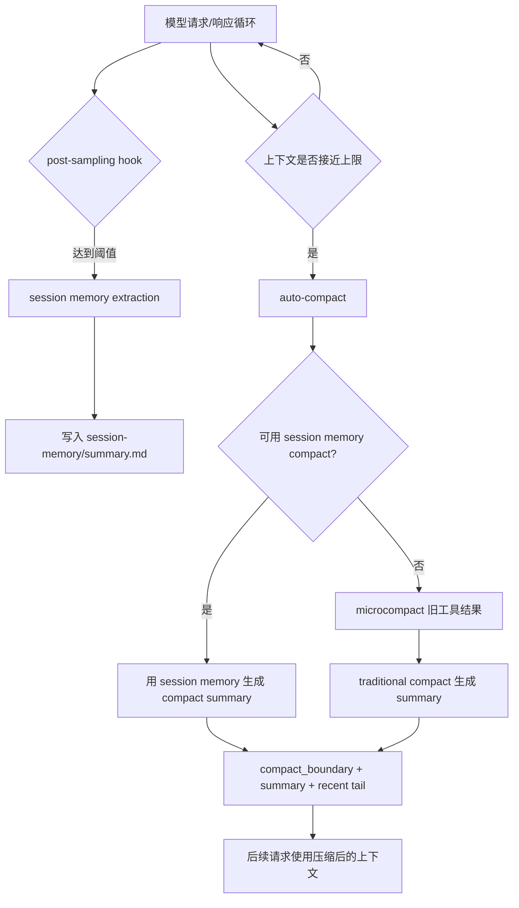

# Memory / Microcompact / Compact 机制说明

本文梳理三类容易混淆的上下文管理机制：`session memory`、`microcompact` 和 `compact`。这三者都服务于长会话续航，但所在层级不同：`session memory` 是旁路摘要，`microcompact` 是局部清理旧工具结果，`compact` 是重写会话上下文。

## 总览

| 机制 | 核心目标 | 是否替换历史上下文 | 是否改变 transcript | 对模型请求上下文的影响 |
| --- | --- | --- | --- | --- |
| session memory extraction | 提取当前 session 的摘要，供后续续航使用 | 否 | 通常不改 transcript 主链；写旁路 memory 文件 | 本身不替换请求历史；被注入或被 session-memory compact 使用时才进入请求 |
| microcompact | 降低旧工具结果的 token 占用 | 否，只清理局部内容 | 会记录局部替换/清理决策；不生成整段 summary | 请求前把旧的大型 `tool_result` 清理或替换成轻量表示 |
| compact | 将旧历史折叠为摘要 | 是 | 是，插入 compact boundary 和 compact summary | 后续请求使用 summary + recent tail，旧历史不再完整携带 |

## 1. Session memory

`session memory` 分为两层：第一层是摘要提取，第二层是使用已提取摘要执行 compact。

### 1.1 Session memory extraction

第一层可以理解为“只提取，不替换”。它读取当前 session 的消息历史，生成一份会话摘要，并写入旁路文件，例如 Claude Code 中的路径形态是：

```text
~/.claude/projects/{sanitized-project-path}/{sessionId}/session-memory/summary.md
```

这一步本身不删除历史消息，不插入 `compact_boundary`，也不把 transcript 主链替换成 summary。它的产物是一个可复用的 session 摘要文件。

执行流程：

1. 在主循环采样结束后注册/执行 post-sampling hook。
2. 检查是否满足提取阈值。
3. 若满足，启动隔离的 forked agent 或专用提取流程。
4. 读取已有 session memory 文件。
5. 根据当前 messages 更新 `summary.md`。
6. 记录“当前摘要覆盖到哪个 message id”，供后续 session-memory compact 判断边界。

触发条件：

- auto-compact 开启时才注册 session memory 的自动提取 hook。
- 当前上下文 token 数达到初始化阈值。Claude Code 默认值是 `10000`。
- 初始化后，每次更新都要求上下文相比上次提取增长达到阈值。Claude Code 默认值是 `5000`。
- 同时满足以下条件之一：
  - 距离上次提取后工具调用数达到阈值。Claude Code 默认值是 `3`。
  - 最后一轮 assistant 没有工具调用，说明当前处于较自然的对话停顿点。
- 手动入口可以绕过阈值，例如 Claude Code 的 `/summary` 类命令。

对模型请求上下文的影响：

- extraction 本身不改变当前模型请求上下文。
- 它只产出旁路摘要文件。
- 只有后续显式注入 session memory，或者触发 session-memory compact 时，摘要才会进入模型请求上下文。

### 1.2 Session-memory compact

第二层才会改变历史上下文。它发生在 compact 流程中：当系统准备压缩上下文时，优先尝试复用 `session-memory/summary.md`，而不是重新让模型从完整旧历史生成摘要。

执行流程：

1. compact 触发后，先检查是否可以使用 session memory compact。
2. 等待正在进行的 session memory extraction 完成，通常有超时保护。
3. 读取 session memory 文件。
4. 如果文件不存在、为空模板、或无法确定摘要边界，则放弃，回退到传统 compact。
5. 根据 `lastSummarizedMessageId` 找到已被摘要覆盖的历史边界。
6. 计算需要保留的 recent tail，并避免切断 `tool_use` / `tool_result` pair 和同一 assistant trajectory 中的 thinking block。
7. 生成 compact result：`compact_boundary + compact summary + recent tail`。

触发条件：

- 用户手动执行 `/compact`，且没有提供自定义 compact 指令；或者 auto-compact 触发。
- session memory compact 功能可用。
- session memory 文件存在，且不是空模板。
- 能确定已摘要消息边界；恢复 session 场景下可走 fallback。
- auto-compact 场景下，还要求 compact 后估算 token 不超过 auto-compact 阈值，否则回退传统 compact。

对模型请求上下文的影响：

```text
旧历史完整 messages
+ session-memory/summary.md
+ recent tail
=> compact summary + recent tail
```

后续请求不再完整携带旧历史，而是携带 session memory 生成的 summary 与保留尾部。

## 2. Microcompact

`microcompact` 是局部上下文减肥机制。它不把整段对话总结成 summary，而是针对旧的、大型工具结果做清理或替换。

典型处理对象包括：

- `Read` / `read_file` 的大文件内容。
- `Bash` / `run_shell` 的长 stdout、stderr。
- `Grep` / `Glob` 的大量搜索结果。
- `WebFetch` / `WebSearch` 的长网页或检索结果。
- `Edit` / `Write` 的冗长 diff 或回显结果。

执行流程：

1. 在请求模型前或 compact 前拿到当前 messages。
2. 找出可 microcompact 的旧 `tool_result`。
3. 保留必要的结构信息，例如 tool id、工具名称、是否成功、必要摘要。
4. 将旧的大内容替换成轻量占位或 cache edit。
5. 确保不破坏 `tool_use` / `tool_result` 配对。
6. 记录 content replacement / microcompact 相关状态，以便 resume 后能重建同样的上下文视图。

触发条件：

- traditional compact 前会先运行 microcompact，以降低 compact summarization 请求的 token 压力。
- `/context` 等上下文统计命令会运行 microcompact 后再估算真实 API 请求上下文。
- 请求前自动 microcompact 可由两类策略触发：
  - time-based microcompact：距离上次主循环 assistant 消息超过阈值后触发。Claude Code 默认配置里阈值是 `60` 分钟，但默认开关为关闭。
  - cached microcompact：需要 feature gate、模型支持 cache editing、当前是 main thread，并满足对应的计数/保留策略。

对 transcript 的影响：

- 它不会把一段旧历史改写成自然语言 summary。
- 但它会记录局部替换/清理决策，确保 resume 时能够恢复“哪些旧工具结果已经被清理”的状态。

对模型请求上下文的影响：

```text
assistant: tool_use(read_file)
user: tool_result(很长的文件内容)
```

会变成类似：

```text
assistant: tool_use(read_file)
user: tool_result([Old tool result content cleared])
```

或通过 cache editing 在 API 层删除旧工具结果内容。模型仍能看到工具调用拓扑，但不再为旧工具输出支付大量 token。

## 3. Compact

`compact` 是真正的上下文折叠机制。它把一段历史对话总结成 summary，并在 transcript 中插入 compact boundary。

执行流程：

1. 判断 compact 是手动触发还是自动触发。
2. 获取 compact boundary 之前的 messages。
3. 手动 `/compact` 且没有自定义指令时，优先尝试 session-memory compact。
4. 如果 session-memory compact 不适用，走 traditional compact。
5. traditional compact 会先运行 microcompact，减少旧工具结果 token。
6. 调用总结模型生成 compact summary。
7. 生成新的上下文结构：

```text
compact_boundary
compact summary message
session-start hooks / restored attachments
recent tail
```

8. 后续模型请求只携带 compact 后的 summary 和 recent tail。

手动触发条件：

- 用户执行 `/compact`。
- 如果带自定义 compact 指令，直接走 traditional compact，因为 session-memory compact 通常不支持自定义摘要指令。
- 如果不带自定义指令，先尝试 session-memory compact，失败后回退 traditional compact。

自动触发条件：

- compact 功能没有被禁用。
- auto-compact 没有被禁用。
- 用户配置中的 `autoCompactEnabled` 为 true。
- 当前 query source 不是 `session_memory` 或 `compact`，避免递归压缩。
- 连续 auto-compact 失败次数没有超过熔断上限。Claude Code 中该上限是 `3`。
- 当前 token 使用超过 auto-compact 阈值。

Claude Code 的阈值近似为：

```text
autoCompactThreshold = effectiveContextWindow - 13000
```

其中：

```text
effectiveContextWindow = modelContextWindow - reservedSummaryOutputTokens
```

`reservedSummaryOutputTokens` 会取模型最大输出和 `20000` 的较小值。源码注释说明这个 `20000` 是参考 compact summary 输出 p99.99 约 `17387` tokens 后设置的安全预留。

对 transcript 的影响：

- 插入 `system` 类型的 `compact_boundary`。
- 插入 `isCompactSummary` 的 summary message。
- compact boundary 之前的旧消息不再作为后续请求的完整上下文发送。
- transcript 文件通常仍保留事件记录，但加载和请求构造时会从 compact boundary 之后重建有效上下文。

对模型请求上下文的影响：

compact 后的请求上下文通常变成：

```text
system prompt
+ stable memory / runtime attachments
+ compact summary
+ recent tail
+ 当前用户输入
```

而不是：

```text
system prompt
+ 从 session 开始至今的完整历史
+ 当前用户输入
```

## 三者的组合顺序

一次长会话中，三者常见组合关系如下：



也可以按层级记忆：

- `session memory extraction`：先把长会话摘要写到旁路文件。
- `microcompact`：请求前或 compact 前清理旧工具结果。
- `compact`：真正折叠历史上下文，改变后续请求结构。

## 对当前项目的设计建议

当前项目如果要借鉴 Claude Code 的设计，可以采用以下边界：

1. `session memory extraction` 不应直接修改 transcript 主链，只写本 session 的旁路摘要文件。
2. `session-memory compact` 只作为 compact 的优先路径，而不是独立替换历史的后台动作。
3. `microcompact` 应按 `tool_use` / `tool_result` pair 操作，避免产生 orphan tool result。
4. thinking block 如果属于同一 assistant trajectory，且后续存在 tool_use，应随该 trajectory 一起保留到 tool_result 完成后再考虑压缩。
5. `compact` 是唯一负责插入 compact boundary 和 compact summary 的机制。
6. 请求构造时应显式区分：
   - transcript 原始记录；
   - microcompact 后的 API view；
   - compact boundary 后的 effective history；
   - ephemeral runtime attachments；
   - durable project memory。

这样可以避免把“记忆提取”“工具结果减肥”“历史摘要替换”混成一个逻辑，便于调试、resume 和 UI 展示。
